# 🎬 ElastiFlix PostgreSQL CDC Lakehouse Lab

> 🟦 **CDC** · 🟪 **Lakehouse** · 🟩 **Medallion Architecture** · 🟨 **SCD Type 2** · 🟥 **BI**
>
> **Laboratorio local, reproducible y orientado a demostración técnica**, construido completamente con contenedores y un único `docker compose up`.

## 1. Propósito

Este documento consolida las decisiones acordadas para diseñar e implementar un laboratorio reproducible de ingeniería de datos end-to-end para **ElastiFlix**.

El laboratorio simulará actividad transaccional sobre PostgreSQL 19, capturará cambios mediante Apache Flink CDC, persistirá las capas de datos con Apache Iceberg sobre almacenamiento S3-compatible local, construirá un modelo dimensional mediante PySpark, materializará productos analíticos para consumo y los expondrá mediante DuckDB y Apache Superset.

Todo el entorno deberá levantarse desde un único `docker-compose.yml`.

> 🎨 **Leyenda visual:** 🥉 Bronze = réplica operacional; 🥈 Silver = modelo dimensional histórico; 🥇 Gold = serving analítico; 🟪 infraestructura compartida; 🟥 consumo BI.

## 2. ✅ Requisitos

### 2.1 Requisitos funcionales

- 📄 Contar con el archivo fuente `raw_data/elastiflix.csv`, derivado del catálogo ElastiFlix y sin los campos vectoriales.
- ☕ Ejecutar un simulador de eventos en Java 25 que lea el CSV y produzca transacciones `INSERT`, `UPDATE` y `DELETE` reales.
- 🐘 Mantener el modelo operacional normalizado dentro de PostgreSQL 19, base `elastiflix`, esquema `catalog`.
- 🌊 Capturar cambios por logical replication mediante Flink CDC.
- 🥉 Replicar PostgreSQL **as-is** en Iceberg Bronze.
- 🥈 Construir Silver mediante PySpark con modelo dimensional, FACT, DIM, bridges y SCD Type 2.
- 🥇 Crear productos analíticos Gold materializados a partir de Silver.
- 🦆 Consultar Gold desde DuckDB.
- 📊 Consumir Gold desde Apache Superset a través de DuckDB.
- ⏱️ Orquestar `bronze_to_silver.py` y `silver_to_gold.py` mediante Apache Airflow.

### 2.2 Requisitos técnicos

- 🐳 Docker Engine con Docker Compose v2.
- CPU x86_64/amd64 o ARM64 con imágenes compatibles para todos los componentes seleccionados.
- Recomendación para una ejecución cómoda del laboratorio: **8 CPU, 16 GB RAM y al menos 30 GB libres**. Este dimensionamiento es una recomendación del diseño y deberá ajustarse al equipo anfitrión.
- Puertos locales disponibles para las interfaces que decidamos publicar, por ejemplo PostgreSQL, Flink UI, Airflow UI, RustFS, Iceberg REST y Superset.
- Acceso a Internet durante el primer build para descargar imágenes y dependencias.
- El runtime final no deberá depender de servicios cloud externos.

### 2.3 Requisitos de interoperabilidad

> 🔑 **Regla de oro:** un tipo de dato del modelo operacional solo se utilizará si puede recorrer de forma segura la cadena **PostgreSQL → Flink CDC → Iceberg → PySpark/DuckDB → Superset**.

Se privilegiarán `bigint`, `integer`, `numeric(p,s)`, `text`, `boolean`, `date` y timestamps interoperables. Se evitarán tipos especializados cuando dificulten CDC o consumo analítico.

## 3. 🧰 Software Stack

Las versiones base recomendadas se fijan para que el laboratorio sea reproducible. Cuando dos componentes mantienen una relación de compatibilidad estricta, esa compatibilidad tiene prioridad sobre usar simplemente “la versión más nueva”.

| Componente | Versión base | Rol |
|---|---:|---|
| PostgreSQL | **19.0** | Base operacional y logical replication |
| Java | **25** | Event Simulator |
| Apache Flink | **2.2.1** | Runtime de streaming |
| Apache Flink CDC | **3.7.0** | PostgreSQL CDC → Iceberg |
| Apache Iceberg runtime para Flink | **1.10.1** | Sink Iceberg compatible con Flink CDC 3.7 / Flink 2.2.1 |
| Apache Iceberg | **1.11.0** | Formato de tablas y APIs usadas por Spark/catalogación |
| Apache Spark / PySpark | **4.3.0** | Bronze → Silver → Gold |
| Apache Airflow | **3.4.0** | Orquestación |
| DuckDB | **1.5.x** | SQL/query engine |
| Apache Superset | **6.1.0** | BI y dashboards |
| RustFS | **1.0.x** | Object storage S3-compatible |
| Iceberg REST Catalog | **compatible con Iceberg REST** | Catálogo compartido |
| Docker Compose | **v2** | Runtime del laboratorio |

> ℹ️ La guía estable de Flink CDC para PostgreSQL → Iceberg documenta Flink **2.2.1**, Flink CDC **3.7.0** e Iceberg Flink runtime **1.10.1** como un conjunto compatible. Spark **4.3.0**, Airflow **3.4.0**, PostgreSQL **19.0**, Iceberg **1.11.0**, Superset **6.1.0** y RustFS **1.0.x** corresponden a releases disponibles durante 2026.

### 3.1 Política de versiones

- 🔒 Las imágenes Docker deberán quedar **pinneadas** a una versión, evitando `latest`.
- 🧪 Las actualizaciones deberán probarse end-to-end antes de modificar el stack base.
- 🔗 Las versiones de Flink, Flink CDC e Iceberg runtime deberán tratarse como un conjunto compatible.
- 📌 Las dependencias Maven/Python deberán fijarse explícitamente cuando sean parte del runtime.

## 4. 🗺️ Diagrama de Arquitectura

```mermaid
flowchart LR
    CSV[📄 ElastiFlix CSV\n6,899 películas] --> JAVA[☕ Java 25\nEvent Simulator]
    JAVA -->|INSERT / UPDATE / DELETE| PG[(🐘 PostgreSQL 19\nelastiflix)]
    PG -->|WAL / Logical Replication| FLINK[🌊 Apache Flink CDC]
    FLINK --> BRONZE[(🥉 Iceberg Bronze\nModelo relacional as-is)]

    AIRFLOW[⏱️ Apache Airflow] -->|Job #1| SPARK1[⚡ PySpark\nBronze → Silver]
    BRONZE --> SPARK1
    SPARK1 --> SILVER[(🥈 Iceberg Silver\nStar Schema + SCD2)]

    AIRFLOW -->|Job #2| SPARK2[⚡ PySpark\nSilver → Gold]
    SILVER --> SPARK2
    SPARK2 --> GOLD[(🥇 Iceberg Gold\nDatasets materializados)]

    GOLD --> DUCK[🦆 DuckDB\nSQL Engine]
    DUCK --> SUPERSET[📊 Apache Superset\nDashboards]

    CATALOG[🧭 Iceberg REST Catalog] -. catálogo .-> FLINK
    CATALOG -. catálogo .-> SPARK1
    CATALOG -. catálogo .-> SPARK2
    CATALOG -. catálogo .-> DUCK

    BRONZE --> STORE[(🪣 RustFS\ns3://warehouse)]
    SILVER --> STORE
    GOLD --> STORE

    classDef source fill:#E3F2FD,stroke:#1565C0,color:#0D47A1;
    classDef compute fill:#E8F5E9,stroke:#2E7D32,color:#1B5E20;
    classDef bronze fill:#FFF3E0,stroke:#EF6C00,color:#E65100;
    classDef silver fill:#ECEFF1,stroke:#546E7A,color:#263238;
    classDef gold fill:#FFF8E1,stroke:#F9A825,color:#6D4C00;
    classDef infra fill:#F3E5F5,stroke:#7B1FA2,color:#4A148C;
    classDef bi fill:#FCE4EC,stroke:#C2185B,color:#880E4F;

    class CSV,PG source;
    class JAVA,FLINK,SPARK1,SPARK2,AIRFLOW compute;
    class BRONZE bronze;
    class SILVER silver;
    class GOLD gold;
    class CATALOG,STORE infra;
    class DUCK,SUPERSET bi;
```



### Flujo principal

**📄 CSV → ☕ Java → 🐘 PostgreSQL → 🌊 Flink CDC → 🥉 Bronze → ⚡ PySpark → 🥈 Silver → ⚡ PySpark → 🥇 Gold → 🦆 DuckDB → 📊 Superset**

### Plano de control y almacenamiento

- 🧭 **Iceberg REST Catalog**: catálogo compartido para las tablas Iceberg.
- 🪣 **RustFS**: almacenamiento físico S3-compatible de Bronze, Silver y Gold.
- ⏱️ **Airflow**: controla únicamente los jobs PySpark del pipeline analítico.
- 🌊 **Flink CDC**: permanece ejecutándose continuamente y no depende del scheduler batch.

---

## 5. 🎯 Principios de diseño acordados

1. El proyecto será completamente autocontenido y reproducible con Docker Compose.
2. La base operacional será PostgreSQL 19 y la base de datos se llamará `elastiflix`.
3. El dataset fuente será un CSV con más de 5,000 registros. La fuente documentada completa contiene 6,899 películas.
4. El CSV no se cargará masivamente con `COPY` como mecanismo principal del laboratorio. Una aplicación Java 25 simulará actividad transaccional insertando registros gradualmente.
5. El simulador Java podrá generar `INSERT`, `UPDATE` y `DELETE` reales sobre PostgreSQL.
6. Apache Flink CDC capturará los cambios de PostgreSQL y los escribirá en Apache Iceberg.
7. Bronze será una réplica `as-is` del modelo relacional normalizado de PostgreSQL.
8. Silver será un modelo dimensional de tipo estrella, con dimensiones, hechos y bridges.
9. Las dimensiones de negocio en Silver soportarán SCD Type 2 cuando corresponda.
10. Apache Airflow gobernará los jobs PySpark de Bronze a Silver y de Silver a Gold.
11. Flink CDC será un proceso continuo y no será ejecutado evento por evento por Airflow.
12. Gold contendrá productos analíticos materializados derivados de Silver y será la fuente de verdad para visualizaciones.
13. DuckDB será el motor SQL de consulta sobre los datos analíticos.
14. Apache Superset consumirá Gold a través de DuckDB.
15. Apache Iceberg será el formato de tablas del lakehouse.
16. Iceberg REST Catalog será el catálogo compartido por Flink, Spark y DuckDB.
17. RustFS será el almacenamiento S3-compatible local donde residirán físicamente los archivos Iceberg.
18. Los tipos vectoriales del dataset original quedan completamente fuera del laboratorio.
19. Los tipos de PostgreSQL se elegirán con una premisa prioritaria: deben poder viajar de forma segura por PostgreSQL -> Flink CDC -> Iceberg -> PySpark/DuckDB -> Superset.
20. Cada volumen persistente de Docker deberá vivir dentro del directorio del servicio al que pertenece, para facilitar la revisión externa.

## 6. 🏗️ Arquitectura end-to-end

```text
raw_data/elastiflix.csv
          |
          v
Java 25 Event Simulator
          |
          | INSERT / UPDATE / DELETE
          v
PostgreSQL 19
Database: elastiflix
          |
          | Logical Replication / CDC
          v
Apache Flink CDC
          |
          v
Apache Iceberg BRONZE
(relational as-is)
          |
          | Airflow -> PySpark Job #1
          v
Apache Iceberg SILVER
(star schema + SCD Type 2)
          |
          | Airflow -> PySpark Job #2
          v
Apache Iceberg GOLD
(materialized analytical datasets)
          |
          v
DuckDB
          |
          v
Apache Superset
```

Infraestructura compartida:

```text
                 Iceberg REST Catalog
                   ^       ^       ^
                   |       |       |
                 Flink   Spark   DuckDB
                   \       |       /
                    \      |      /
                     v     v     v
                       RustFS
                  s3://warehouse/
```

## 7. 📁 Estructura propuesta del repositorio

El directorio raíz acordado es:

```text
posgresql-cdc-duckdb/
```

Se conserva este nombre tal como fue solicitado.

```text
posgresql-cdc-duckdb/
|
|-- docker-compose.yml
|-- .env
|-- README.md
|-- LAB-DESIGN.md
|
|-- raw_data/
|   `-- elastiflix.csv
|
|-- java-simulator/
|   |-- Dockerfile
|   |-- pom.xml
|   `-- src/
|
|-- postgresql/
|   |-- Dockerfile
|   |-- data/
|   |-- init/
|   `-- scripts/
|
|-- flink/
|   |-- Dockerfile
|   |-- config/
|   |-- jobs/
|   `-- lib/
|
|-- iceberg/
|   |-- config/
|   `-- data/
|
|-- rustfs/
|   `-- data/
|
|-- pyspark/
|   |-- Dockerfile
|   |-- jobs/
|   |   |-- bronze_to_silver.py
|   |   `-- silver_to_gold.py
|   `-- conf/
|
|-- airflow/
|   |-- Dockerfile
|   |-- data/
|   |-- dags/
|   |-- logs/
|   |-- config/
|   `-- plugins/
|
|-- duckdb/
|   |-- Dockerfile
|   |-- data/
|   `-- init/
|
`-- superset/
    |-- Dockerfile
    |-- data/
    `-- config/
```

### Regla de persistencia

Cada bind mount o volumen persistente deberá residir dentro del directorio del servicio propietario.

Ejemplos:

```yaml
postgresql:
  volumes:
    - ./postgresql/data:/var/lib/postgresql/data

rustfs:
  volumes:
    - ./rustfs/data:/data

airflow:
  volumes:
    - ./airflow/dags:/opt/airflow/dags
    - ./airflow/logs:/opt/airflow/logs

superset:
  volumes:
    - ./superset/data:/app/superset_home
```

No se utilizará un directorio raíz genérico `volumes/`.

## 8. 🎞️ Dataset fuente ElastiFlix

La fuente documentada es el índice Elasticsearch `elastiflix-reloaded`, cuyo índice concreto corresponde a `elastiflix-dq-staging-20261113-220031` en la fotografía de datos proporcionada.

Características documentadas:

- 6,899 películas.
- Una película por documento.
- `_id` coincide con `id`.
- `id` corresponde al TMDB movie id y será la clave natural de película.
- Todas las propiedades no vectoriales están presentes en `_source`; algunas pueden contener `null` o arrays vacíos.

### Tipos vectoriales expresamente excluidos

No se modelarán ni propagarán:

```text
plot_1024
plot_512
plot_256
```

La exclusión aplica a:

- CSV operativo del laboratorio, cuando sea posible;
- PostgreSQL;
- Bronze;
- Silver;
- Gold;
- DuckDB;
- Superset.

## 9. ☕ Aplicación Java 25 Event Simulator

La aplicación de consola Java 25 será responsable de simular una aplicación transaccional real.

### Responsabilidades

1. Leer secuencialmente el CSV de `raw_data`.
2. Deserializar los objetos y arrays JSON incluidos dentro de las celdas CSV.
3. Resolver el modelo relacional normalizado.
4. Ejecutar transacciones JDBC reales sobre PostgreSQL.
5. Generar `INSERT` progresivos para crear sensación de eventos en tiempo real.
6. Generar también `UPDATE` y `DELETE` sobre registros existentes.
7. Respetar claves primarias, claves foráneas y tablas puente.
8. Mostrar en consola la actividad que está generando.
9. Permitir comportamiento reproducible mediante una semilla aleatoria.

### Configuración propuesta

```text
SIMULATOR_DELAY_MS
SIMULATOR_INSERT_WEIGHT
SIMULATOR_UPDATE_WEIGHT
SIMULATOR_DELETE_WEIGHT
SIMULATOR_RANDOM_SEED
SIMULATOR_CONTINUOUS
```

Los pesos serán configurables y no forman parte de una restricción del modelo.

### Semántica transaccional

Una fila CSV puede afectar varias tablas. La carga de una película deberá ejecutarse de manera transaccional:

```text
BEGIN
  resolver/crear collection
  resolver/crear catálogos
  insertar movie
  insertar genres/bridges
  insertar keywords/bridges
  insertar cast/bridges
  insertar companies/bridges
  insertar countries/bridges
  insertar spoken languages/bridges
  insertar enrichment
COMMIT
```

Flink verá cambios físicos de múltiples tablas originados por las transacciones normales de PostgreSQL.

## 10. 🐘 PostgreSQL 19

### Base operacional

```text
Database: elastiflix
Schema:   catalog
```

PostgreSQL representará el estado operacional vigente. El historial analítico será responsabilidad de Silver.

### CDC

PostgreSQL se configurará para logical replication.

Parámetros mínimos a contemplar:

```text
wal_level = logical
max_replication_slots > 0
max_wal_senders > 0
```

Las tablas capturadas tendrán primary key y se configurarán con `REPLICA IDENTITY FULL` en este laboratorio para facilitar eventos completos de UPDATE y DELETE.

## 11. 🔗 Contrato de tipos interoperables

La prioridad es la interoperabilidad, no utilizar indiscriminadamente tipos específicos de PostgreSQL.

### Tipos preferidos

```text
PostgreSQL                   Uso
-------------------------------------------------
bigint                       claves
integer                      conteos/posiciones
numeric(p,s)                 valores decimales exactos
text                         texto/códigos
boolean                      indicadores
date                         fecha de calendario
timestamp(6) with time zone  timestamps operativos
```

### Tipos que evitaremos en las tablas CDC

```text
json/jsonb
enum
domain
money
arrays PostgreSQL
range/multirange
citext
inet/cidr
tipos compuestos
tipos vectoriales
```

Las validaciones específicas se implementarán preferentemente con `CHECK`, PK, FK y UNIQUE.

### Decimales

Los decimales siempre declararán precisión y escala explícitas.

```text
budget_usd    numeric(18,2)
revenue_usd   numeric(18,2)
popularity    numeric(10,3)
user_score    numeric(3,1)
vote_average  numeric(5,3)
```

No se utilizará `money`.

## 12. 🧩 Modelo relacional normalizado PostgreSQL

### 9.1 Inventario

Entidades/catálogos:

```text
movie
collection
genre
keyword
person
production_company
production_country
original_language
spoken_language
movie_status
content_rating
enrichment_field
```

Relaciones:

```text
movie_collection
movie_genre
movie_keyword
movie_cast
movie_production_company
movie_production_country
movie_spoken_language
movie_enrichment
```

### 9.2 `movie`

Clave natural: TMDB `movie_id`.

```text
movie_id                bigint PK
imdb_id                 text NULL
title                   text NOT NULL
original_title          text NOT NULL
original_language_code  text NOT NULL FK
overview                text NULL
plot                    text NOT NULL
tagline                 text NULL
status_code             text NOT NULL FK
rating_code             text NULL FK
release_date            date NOT NULL
runtime_minutes         integer NULL
budget_usd              numeric(18,2) NULL
revenue_usd             numeric(18,2) NULL
popularity              numeric(10,3) NOT NULL
user_score              numeric(3,1) NULL
vote_average            numeric(5,3) NULL
vote_count              integer NULL
adult                   boolean NOT NULL
video                   boolean NOT NULL
homepage                text NULL
poster_path             text NULL
backdrop_path           text NULL
created_at              timestamptz NOT NULL
updated_at              timestamptz NOT NULL
```

Reglas principales:

- `movie_id > 0`.
- `imdb_id`, cuando exista, debe respetar el patrón documentado `tt` + 7/8 dígitos.
- `runtime_minutes > 0` cuando no sea null.
- `budget_usd` y `revenue_usd` mantienen `NULL` como ausencia; no se reemplazan por cero.
- `popularity >= 0`.
- scores entre 0 y 10.
- `vote_count > 0` cuando exista.
- `homepage` acepta únicamente valores HTTP/HTTPS cuando está presente.
- `poster_path` y `backdrop_path` son rutas relativas.

Índices únicos parciales previstos para `imdb_id` y `poster_path` cuando no son null.

### 9.3 `collection`

```text
collection_id   bigint PK
name            text NOT NULL
created_at      timestamptz
updated_at      timestamptz
```

El nombre no será UNIQUE porque existen IDs distintos con el mismo nombre.

Los `poster_path` y `backdrop_path` observados no son atributos estables de la entidad. Se preservarán en `movie_collection`.

### 9.4 `movie_collection`

```text
movie_id                bigint PK/FK
collection_id           bigint FK
observed_poster_path    text NULL
observed_backdrop_path  text NULL
source_position         integer
```

Representa la relación película 0..1 colección.

### 9.5 `genre`

```text
genre_id   bigint GENERATED ALWAYS AS IDENTITY PK
name       text UNIQUE NOT NULL
```

### 9.6 `movie_genre`

```text
movie_id        bigint FK
genre_id        bigint FK
source_position integer
PK(movie_id, genre_id)
UNIQUE(movie_id, source_position)
```

### 9.7 `keyword`

```text
keyword_id  bigint PK
name        text NOT NULL
created_at  timestamptz
updated_at  timestamptz
```

No habrá `UNIQUE(name)` porque existen conflictos id/nombre.

Política inicial: el primer nombre observado para un `keyword_id` será canónico; discrepancias posteriores serán registradas.

### 9.8 `movie_keyword`

```text
movie_id        bigint FK
keyword_id      bigint FK
source_position integer
PK(movie_id, keyword_id)
UNIQUE(movie_id, source_position)
```

### 9.9 `person`

```text
person_id   bigint GENERATED ALWAYS AS IDENTITY PK
name        text UNIQUE NOT NULL
created_at  timestamptz
```

La unicidad es técnica por nombre exacto del dataset. No implica que sea posible resolver homónimos reales.

### 9.10 `movie_cast`

```text
movie_id       bigint FK
person_id      bigint FK
billing_order  integer NOT NULL
PK(movie_id, person_id)
UNIQUE(movie_id, billing_order)
```

Se preservará el orden de facturación.

### 9.11 `production_company`

```text
company_id  bigint GENERATED ALWAYS AS IDENTITY PK
name        text UNIQUE NOT NULL
```

No se fusionarán automáticamente variantes de nombres de estudios.

### 9.12 `movie_production_company`

```text
movie_id        bigint FK
company_id      bigint FK
source_position integer
PK(movie_id, company_id)
```

### 9.13 `production_country`

```text
country_id  bigint GENERATED ALWAYS AS IDENTITY PK
name        text UNIQUE NOT NULL
```

PostgreSQL/Bronze preservarán los valores fuente incluso cuando tengan problemas de calidad, por ejemplo `Guadaloupe`. Su estandarización pertenece a Silver.

### 9.14 `movie_production_country`

```text
movie_id        bigint FK
country_id      bigint FK
source_position integer
PK(movie_id, country_id)
```

### 9.15 `original_language`

```text
language_code  text PK
description    text NULL
```

La validación permitirá códigos de dos letras usados por el dataset, incluido `cn` como convención TMDB.

### 9.16 `spoken_language`

```text
spoken_language_id  bigint GENERATED ALWAYS AS IDENTITY PK
name                text UNIQUE NOT NULL
```

`No Language` es un valor válido, no un null.

### 9.17 `movie_spoken_language`

```text
movie_id            bigint FK
spoken_language_id  bigint FK
source_position     integer
PK(movie_id, spoken_language_id)
```

### 9.18 `movie_status`

Inicialmente contiene `Released`, pero se implementa como tabla y no como ENUM para permitir evolución.

```text
status_code text PK
```

### 9.19 `content_rating`

Valores iniciales documentados:

```text
G
PG
PG-13
R
NC-17
NR
TV-PG
```

```text
rating_code text PK
```

### 9.20 `enrichment_field`

Catálogo de los 21 campos documentados de `enrichment`.

```text
field_name text PK
```

### 9.21 `movie_enrichment`

```text
movie_id    bigint FK
field_name  text FK
code        text NOT NULL
PK(movie_id, field_name)
```

Los códigos permanecen abiertos porque existen familias como:

```text
wikipedia_infobox_fx:<MONEDA>:<AÑO>
```

## 13. Política de DELETE en PostgreSQL

Un `DELETE` sobre `movie` eliminará sus relaciones mediante `ON DELETE CASCADE`, pero no eliminará las entidades compartidas.

Se eliminarán las asociaciones:

```text
movie_collection
movie_genre
movie_keyword
movie_cast
movie_production_company
movie_production_country
movie_spoken_language
movie_enrichment
```

No se eliminarán automáticamente:

```text
collection
genre
keyword
person
production_company
production_country
spoken_language
```

No se utilizará `deleted_at` para simular borrados: la aplicación realizará DELETE físicos para que CDC observe eliminaciones reales.

## 14. 🌊 Flink CDC

Flink CDC será responsable de:

1. Snapshot inicial cuando corresponda.
2. Lectura continua del WAL de PostgreSQL.
3. Captura de INSERT, UPDATE y DELETE.
4. Escritura de tablas Bronze en Iceberg.
5. Mantener el pipeline CDC ejecutándose continuamente.

Bronze reproducirá el modelo PostgreSQL tabla por tabla.

Ejemplos:

```text
catalog.movie                     -> bronze.movie
catalog.collection                -> bronze.collection
catalog.movie_genre               -> bronze.movie_genre
catalog.movie_cast                -> bronze.movie_cast
catalog.movie_enrichment          -> bronze.movie_enrichment
```

Las modificaciones DDL deberán coordinarse deliberadamente entre PostgreSQL y el pipeline; no se asumirán cambios de esquema transparentes desde el WAL.

## 15. 🪣 RustFS

RustFS será el object storage S3-compatible local.

Conceptualmente:

```text
s3://warehouse/
  bronze/
  silver/
  gold/
```

Los archivos físicos Iceberg, incluyendo datos Parquet y metadata asociada, residirán en RustFS.

Persistencia local:

```text
rustfs/data/
```

Los demás servicios no manipularán directamente ese directorio. Accederán mediante el endpoint S3.

## 16. 🧭 Iceberg REST Catalog

Existirá como servicio independiente.

Clientes:

```text
Flink CDC
PySpark
DuckDB
```

Será la capa común de descubrimiento y coordinación de las tablas Iceberg almacenadas en RustFS.

DuckDB será cliente del catálogo, no propietario exclusivo de este.

## 17. 🥉 Capa BRONZE

### Objetivo

Réplica relacional `as-is` del sistema operacional PostgreSQL.

No se realiza modelado dimensional en esta capa.

Inventario aproximado:

```text
bronze.movie
bronze.collection
bronze.movie_collection
bronze.genre
bronze.movie_genre
bronze.keyword
bronze.movie_keyword
bronze.person
bronze.movie_cast
bronze.production_company
bronze.movie_production_company
bronze.production_country
bronze.movie_production_country
bronze.original_language
bronze.spoken_language
bronze.movie_spoken_language
bronze.movie_status
bronze.content_rating
bronze.enrichment_field
bronze.movie_enrichment
```

Bronze conserva problemas de calidad de la fuente. Las correcciones pertenecen a Silver.

## 18. ⏱️ Apache Airflow

Airflow gobernará exclusivamente el procesamiento analítico PySpark.

Pipeline lógico:

```text
validate_bronze
      |
      v
bronze_to_silver
      |
      v
validate_silver
      |
      v
silver_to_gold
      |
      v
validate_gold
```

Airflow no gobernará cada evento CDC.

## 19. ⚡ Job PySpark #1: Bronze → Silver

Archivo previsto:

```text
pyspark/jobs/bronze_to_silver.py
```

Responsabilidades:

- leer cambios/datos Bronze;
- deduplicar por business key;
- realizar data quality;
- conformar dimensiones;
- generar surrogate keys;
- aplicar SCD Type 2;
- gestionar eventos tardíos de forma determinística;
- actualizar dimensiones;
- construir tablas FACT;
- construir bridges N:M;
- preservar historial de DELETE;
- escribir tablas Iceberg Silver.

## 20. 🥈 Modelo dimensional SILVER

Silver será un esquema estrella extendido con bridge tables.

### 17.1 Dimensiones

```text
silver.dim_date
silver.dim_movie
silver.dim_collection
silver.dim_original_language
silver.dim_status
silver.dim_rating
silver.dim_genre
silver.dim_keyword
silver.dim_person
silver.dim_production_company
silver.dim_production_country
silver.dim_spoken_language
silver.dim_enrichment_field
silver.dim_enrichment_code
```

### 17.2 Hechos

```text
silver.fact_movie_snapshot
silver.fact_movie_enrichment
```

### 17.3 Bridges

```text
silver.bridge_movie_genre
silver.bridge_movie_keyword
silver.bridge_movie_cast
silver.bridge_movie_production_company
silver.bridge_movie_production_country
silver.bridge_movie_spoken_language
```

Total propuesto: 14 dimensiones, 2 hechos y 6 bridges.

## 21. 🕰️ SCD Type 2

Las dimensiones de negocio deberán soportar SCD Type 2 cuando corresponda.

Patrón técnico:

```text
<entity>_sk
<business_key>
<attributes>
effective_from
effective_to
is_current
version_number
attribute_hash
source_updated_at
silver_processed_at
```

Convención temporal:

```text
[effective_from, effective_to)
```

La versión vigente tendrá `is_current = true`.

`dim_date` será estática y no requiere SCD2.

El procedimiento conceptual será:

1. Deduplicar por business key.
2. Calcular `attribute_hash`.
3. Comparar contra la versión vigente.
4. Cerrar la versión previa si cambió.
5. Insertar una nueva versión.
6. Resolver surrogate keys.
7. Cargar hechos y bridges.

## 22. `dim_movie`

Grain: una versión histórica de una película.

Atributos propuestos:

```text
movie_sk
movie_id
imdb_id
title
original_title
overview
plot
tagline
release_date
release_year
release_month
release_decade
homepage
poster_path
backdrop_path
adult
video
effective_from
effective_to
is_current
version_number
attribute_hash
source_updated_at
silver_processed_at
```

Las medidas variables no se almacenarán aquí.

## 23. `dim_collection`

```text
collection_sk
collection_id
collection_name
canonical_poster_path
canonical_backdrop_path
effective_from
effective_to
is_current
version_number
attribute_hash
source_updated_at
silver_processed_at
```

Los paths canónicos se decidirán con una regla determinística. La propuesta inicial es conservar el primer valor no nulo observado y versionar posteriores cambios aceptados.

## 24. Dimensiones de catálogo

### `dim_original_language`

```text
original_language_sk
language_code
language_name
is_tmdb_specific
SCD2 columns
```

### `dim_status`

```text
status_sk
status_code
status_description
SCD2 columns
```

### `dim_rating`

```text
rating_sk
rating_code
rating_system
rating_description
SCD2 columns
```

No se asignarán significados no respaldados por reglas explícitas del laboratorio.

## 25. Dimensiones multivalor

### `dim_genre`

```text
genre_sk
genre_id
genre_name
SCD2 columns
```

### `dim_keyword`

```text
keyword_sk
keyword_id
keyword_name
SCD2 columns
```

### `dim_person`

```text
person_sk
person_id
person_name
SCD2 columns
```

### `dim_production_company`

```text
company_sk
company_id
company_name
SCD2 columns
```

### `dim_production_country`

```text
country_sk
country_id
source_country_name
standard_country_name
country_code
quality_status
SCD2 columns
```

Silver podrá corregir/estandarizar valores sin destruir el valor fuente.

### `dim_spoken_language`

```text
spoken_language_sk
spoken_language_id
source_language_name
standard_language_name
language_code
quality_status
SCD2 columns
```

`No Language` será una fila real distinta de Unknown.

## 26. `dim_date`

Grain: una fecha de calendario.

```text
date_sk
calendar_date
day_number
day_name
day_of_week
week_of_year
month_number
month_name
quarter_number
year_number
decade_number
is_weekend
```

`date_sk` podrá expresarse como `YYYYMMDD`.

## 27. `fact_movie_snapshot`

Grain acordado:

> Una fila por película y versión de métricas observada por el procesamiento Silver.

Campos propuestos:

```text
movie_snapshot_sk
movie_sk
collection_sk
original_language_sk
status_sk
rating_sk
release_date_sk
snapshot_date_sk
movie_id
snapshot_at
runtime_minutes
budget_usd
revenue_usd
profit_usd
roi_percentage
popularity
user_score
vote_average
vote_count
genre_count
keyword_count
cast_count
company_count
country_count
spoken_language_count
has_collection
has_budget
has_revenue
has_homepage
is_deleted
source_updated_at
silver_processed_at
record_hash
```

### Medidas derivadas

```text
profit_usd = revenue_usd - budget_usd
```

Solo cuando ambos existen.

```text
roi_percentage = ((revenue_usd - budget_usd) / budget_usd) * 100
```

Solo cuando el presupuesto existe y es mayor que cero y existe revenue.

Los valores ausentes no se convierten en cero.

## 28. Bridges

### `bridge_movie_genre`

```text
movie_sk
genre_sk
source_position
allocation_weight
effective_from
effective_to
is_current
```

### `bridge_movie_keyword`

```text
movie_sk
keyword_sk
source_position
allocation_weight
effective_from
effective_to
is_current
```

### `bridge_movie_cast`

```text
movie_sk
person_sk
billing_order
is_lead_cast
allocation_weight
effective_from
effective_to
is_current
```

La regla de `is_lead_cast` se definirá únicamente cuando exista un requisito analítico concreto.

### `bridge_movie_production_company`

```text
movie_sk
company_sk
source_position
allocation_weight
effective_from
effective_to
is_current
```

### `bridge_movie_production_country`

```text
movie_sk
country_sk
source_position
allocation_weight
effective_from
effective_to
is_current
```

### `bridge_movie_spoken_language`

```text
movie_sk
spoken_language_sk
source_position
allocation_weight
effective_from
effective_to
is_current
```

`allocation_weight` permitirá análisis sin doble conteo cuando sea apropiado.

## 29. Procedencia en Silver

### `dim_enrichment_field`

```text
enrichment_field_sk
field_name
field_description
SCD2 columns
```

### `dim_enrichment_code`

```text
enrichment_code_sk
code
source_family
source_system
source_date_text
currency_code
currency_year
SCD2 columns
```

Permitirá interpretar códigos como:

```text
wikipedia_infobox_fx:EUR:2003
```

sin perder el código original.

### `fact_movie_enrichment`

Factless fact.

Grain:

> Una relación entre una versión de película, un campo y su código de procedencia.

```text
movie_sk
enrichment_field_sk
enrichment_code_sk
observed_at
is_current
silver_processed_at
```

## 30. Filas dimensionales especiales

Se reservarán claves para casos técnicos:

```text
SK = 0   Unknown
SK = -1  Not Applicable
```

Ejemplos:

- película sin colección -> `collection_sk = -1`;
- rating desconocido/nulo -> `rating_sk = 0`;
- dimensión aún no disponible -> temporalmente `SK = 0`.

## 31. Semántica Silver para INSERT/UPDATE/DELETE

### INSERT

1. Resolver/crear dimensiones.
2. Insertar `dim_movie`.
3. Insertar `fact_movie_snapshot`.
4. Insertar bridges.
5. Insertar procedencia.

### UPDATE descriptivo

1. Localizar versión vigente por business key.
2. Comparar `attribute_hash`.
3. Cerrar la versión vigente.
4. Insertar nueva versión SCD2.
5. Resolver nueva surrogate key.
6. Insertar nuevo snapshot cuando corresponda.

### UPDATE de medidas

Cambios únicamente en medidas como:

```text
popularity
vote_count
vote_average
user_score
budget
revenue
```

no necesitan crear una nueva versión de `dim_movie`; generan una nueva versión de hechos cuando exista un cambio analíticamente relevante.

### DELETE

Silver no elimina físicamente el historial:

1. cerrar versiones dimensionales vigentes;
2. cerrar bridges activos;
3. registrar el estado eliminado en el hecho;
4. conservar el historial.

## 32. ⚡ Job PySpark #2: Silver → Gold

Archivo previsto:

```text
pyspark/jobs/silver_to_gold.py
```

Responsabilidades:

- leer DIM/FACT/bridges de Silver;
- seleccionar versiones vigentes o snapshots apropiados;
- realizar joins;
- filtrar;
- agregar;
- calcular KPIs;
- materializar productos analíticos como tablas Iceberg Gold;
- generar estructuras simples para DuckDB/Superset.

Gold no obligará a Superset a resolver directamente la complejidad SCD2 o de bridges.

## 33. 🥇 Capa GOLD

Gold contendrá resultados materializados mediante PySpark. Aunque conceptualmente operen como vistas materializadas del negocio, la implementación local será mediante tablas Iceberg materializadas por el job PySpark.

Productos candidatos:

```text
gold.movie_current_overview
gold.genre_performance
gold.collection_performance
gold.financial_performance
gold.release_trends
gold.cast_analysis
gold.data_quality_coverage
```

Los nombres y KPIs exactos quedarán sujetos al diseño final de dashboards.

Gold deberá exponer tipos simples y amigables para BI:

```text
bigint
integer
decimal(p,s)
string
boolean
date
timestamp
```

## 34. 🦆 DuckDB

DuckDB funcionará como SQL/query engine, no como almacenamiento primario ni como Iceberg Catalog.

Responsabilidades:

- conectarse al Iceberg REST Catalog;
- leer las tablas Gold en RustFS;
- exponer una interfaz SQL para consumo;
- servir como backend SQL de Apache Superset.

DuckDB podrá utilizar vistas SQL locales sobre las tablas Gold si simplifican el consumo.

## 35. 📊 Apache Superset

Superset será la capa de visualización.

No consultará PostgreSQL, Flink ni Bronze directamente.

Ruta de consumo:

```text
Superset -> DuckDB -> Iceberg Gold -> RustFS
```

Gold será la fuente de verdad para las visualizaciones.

## 36. Calidad de datos

La filosofía acordada es:

```text
PostgreSQL  -> conserva semántica fuente
Bronze      -> réplica as-is
Silver      -> limpia, conforma, historiza
Gold        -> sirve métricas y productos analíticos
```

Ejemplos documentados que podrán resolverse en Silver:

- `Guadaloupe` -> posible estandarización a `Guadeloupe`, conservando el valor fuente.
- variantes de nombres de compañías no se fusionarán sin una regla explícita.
- variantes de nombres de personas no se fusionarán automáticamente.
- `cn` se conservará como código TMDB.
- `No Language` seguirá siendo un valor real.
- conflictos en keyword id/nombre se manejarán de forma determinística.
- `budget` y `revenue` mantienen null como ausencia, nunca cero sintético.
- `user_score` y `vote_average` siguen siendo medidas distintas.
- `plot` puede reflejar una extracción truncada alrededor de 3,000 caracteres; no se inventará contenido faltante.

## 37. Particionamiento Iceberg

No se particionarán inicialmente dimensiones pequeñas.

Para `fact_movie_snapshot`, debido al volumen modesto del laboratorio, se evaluará:

```text
sin partición
```

o, si las ejecuciones generan suficiente historial:

```text
months(snapshot_at)
```

Se evitará una granularidad excesiva que genere demasiados archivos pequeños.

## 38. Consideraciones de mantenimiento Iceberg

Los cambios fila a fila, SCD2 y MERGE pueden generar archivos adicionales. El laboratorio deberá contemplar eventualmente:

- compactación;
- expiración de snapshots;
- limpieza de archivos huérfanos;
- validación del número/tamaño de archivos.

Estas tareas se incorporarán solo cuando sea necesario para demostrar operación del lakehouse y no deben oscurecer el flujo principal.

## 39. 🐳 Docker Compose

Un único comando deberá levantar el laboratorio completo:

```bash
docker compose up -d --build
```

Servicios conceptuales:

```text
postgresql
java-simulator
flink-jobmanager
flink-taskmanager
iceberg-rest
rustfs
spark-master
spark-worker
airflow
duckdb
superset
```

El número final de servicios Airflow podrá variar según el executor elegido, pero todos deberán declararse en el mismo Docker Compose.

## 40. Orden de dependencias esperado

Conceptualmente:

```text
RustFS
  |
  +--> Iceberg REST Catalog

PostgreSQL
  |
  +--> Flink CDC
  |      |
  |      +--> Iceberg REST + RustFS
  |
  +--> Java Simulator

Spark + Iceberg REST + RustFS
  |
  +--> Airflow jobs

DuckDB + Iceberg REST + RustFS
  |
  +--> Superset
```

Se utilizarán healthchecks y condiciones de readiness cuando resulte necesario para evitar carreras durante `docker compose up`.

## 41. Separación de responsabilidades

| Componente | Responsabilidad |
|---|---|
| CSV | Fuente inicial de películas |
| Java 25 simulator | Generación de actividad transaccional |
| PostgreSQL 19 | Sistema operacional normalizado |
| Flink CDC | Captura continua de cambios |
| Iceberg Bronze | Réplica relacional as-is |
| PySpark #1 | Construcción dimensional + calidad + SCD2 |
| Iceberg Silver | Warehouse dimensional histórico |
| PySpark #2 | Construcción de productos analíticos |
| Iceberg Gold | Serving layer materializada |
| Airflow | Orquestación de jobs PySpark |
| Iceberg REST Catalog | Catálogo lakehouse compartido |
| RustFS | Object storage S3-compatible |
| DuckDB | Motor SQL analítico |
| Superset | Dashboards y visualización |
| Docker Compose | Runtime reproducible del laboratorio |

## 42. Flujo demostrativo esperado

Una demostración completa deberá poder mostrar:

1. Arranque de todo el stack con Docker Compose.
2. PostgreSQL inicialmente preparado con esquema pero sin la carga completa de películas.
3. Arranque de Flink CDC.
4. Java comienza a emitir las películas desde el CSV mediante INSERT.
5. El observador ve llegar las filas a PostgreSQL.
6. Flink captura los cambios.
7. Bronze se actualiza en Iceberg/RustFS.
8. Java genera UPDATE y DELETE posteriores.
9. Los cambios se reflejan mediante CDC.
10. Airflow ejecuta `bronze_to_silver`.
11. Silver crea/actualiza dimensiones SCD2, hechos y bridges.
12. Airflow ejecuta `silver_to_gold`.
13. Gold materializa datasets analíticos.
14. DuckDB consulta Gold.
15. Superset refleja los resultados en dashboards.

## 43. Decisiones expresamente descartadas

No se utilizará:

- BigQuery para este laboratorio local;
- carga exclusivamente batch del CSV hacia PostgreSQL;
- DuckDB como sustituto del Iceberg REST Catalog;
- almacenamiento directo de Iceberg en carpetas manipuladas independientemente por cada motor;
- vectores o embeddings;
- JSON/arrays como sustitutos de la normalización operacional;
- Airflow como controlador evento-a-evento de Flink CDC;
- Superset accediendo directamente a Bronze o PostgreSQL para los dashboards finales;
- DELETE lógico como sustituto general del DELETE físico en el simulador operacional;
- `money` para montos;
- tipos PostgreSQL especializados que dificulten la interoperabilidad del CDC.

## 44. 🚀 Trabajo siguiente

Con esta arquitectura y modelos definidos, la implementación puede avanzar en este orden:

1. Fijar versiones compatibles de PostgreSQL 19, Java 25, Flink/Flink CDC, Iceberg, Spark, Airflow, DuckDB, Superset y RustFS.
2. Implementar DDL PostgreSQL completo.
3. Implementar inicialización de logical replication.
4. Preparar el CSV completo de 6,899 películas sin vectores.
5. Construir Java Event Simulator.
6. Configurar RustFS e Iceberg REST Catalog.
7. Configurar Flink CDC PostgreSQL -> Iceberg Bronze.
8. Crear catálogo y namespaces `bronze`, `silver`, `gold`.
9. Implementar `bronze_to_silver.py`.
10. Implementar SCD Type 2 y bridges.
11. Implementar `silver_to_gold.py`.
12. Configurar Airflow DAG.
13. Configurar DuckDB contra Iceberg.
14. Configurar Superset contra DuckDB.
15. Agregar healthchecks, observabilidad básica y validaciones.
16. Construir dashboards y KPIs finales.
17. Ejecutar una prueba end-to-end con INSERT, UPDATE y DELETE.

## 45. ✅ Criterio de éxito

El laboratorio se considerará exitoso cuando un revisor externo pueda clonar/copiar el proyecto, levantarlo con Docker Compose y observar un cambio real generado por Java recorrer de extremo a extremo:

```text
CSV
 -> Java transaction
 -> PostgreSQL WAL
 -> Flink CDC
 -> Iceberg Bronze
 -> Airflow/PySpark
 -> Silver dimensional/SCD2
 -> Airflow/PySpark
 -> Gold materializado
 -> DuckDB
 -> Apache Superset
```

El diseño debe ser comprensible desde la estructura de directorios y mantener una separación clara de responsabilidades entre ingestión, CDC, almacenamiento, catálogo, transformación, orquestación, serving y visualización.
